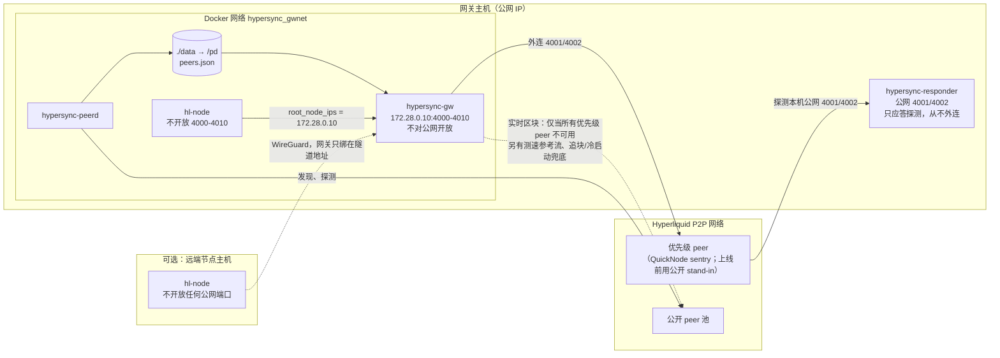

# hypersync 部署指南

本文档说明怎样把 hypersync 部署到运行 Hyperliquid hl-node 的服务器上，以及怎样接入其它机器上的节点。
流程按 2026-10-28 ~ 11-03 的测试实际验证过的方式写（单节点同机约 41 h、Linode 远端节点 10 h、受控停顿
测试），网关版本 `18f6864`。

## 1. 拓扑



- **网关**为每个节点挑一个上游 peer，转发状态数据（冷启动）、实时区块（4001）和追块请求（4002），并在上游停顿、
  落后或异常时几秒内换掉它。一个网关可以同时服务多个节点（按节点来源 IP 区分）。
- **peerd** 发现并探测公开 peer，按约 120 s 一轮运行，得到可用的 peer 池时更新 `data/peers.json`。
- **优先级 peer**（`HYPERSYNC_PRIORITY_PEERS`）优先使用。默认独占模式下，节点的**实时区块**只在全部优先级 peer
  都不可用时才来自公开池；公开池另有三处用途：两条测速参考流（只测速，不给节点供块）、冷启动在优先级 peer
  领先 8 s 仍未成功后可参与竞争、单个 4002 追块请求在优先级 peer 6 s 未应答后可转给公开池。
- **应答器**接管本机公网 4001/4002：上游 peer（包括 QuickNode sentry）会回头探测与它们连接的 IP，没人应答会被降级。
  有了应答器，节点就不需要任何公网端口。它是 hypersync 唯一面向公网的监听。
- 节点只连网关（`try_new_peers: false`），不再直接连公网 peer。

## 2. 关键结论

- **网关绝不能对公网开放。** 任何能连上它的人都能触发一次约 5.8 GB 的状态数据转发。公网上只允许应答器。
- **资源**：单节点测试中 hypersync 三个组件合计 < 100 MB 内存（网关峰值实测 69 MB，稳态约 6 MB；peerd ~18 MB；
  应答器 ~4 MB），CPU ~1%。不开 `--cache` 时，每个进行中的冷启动会让网关多占约 64 MB，多个节点同时冷启动时相应增加。内存压力全部来自 hl-node：同机测试里它从 ~15 GiB 涨到 30+ GiB，62 GB 主机上每 3~6 小时低内存重启一次，
  偶尔先冻结 20 分钟。**hl-node 所在主机建议 ≥128 GB。** 网关可以放在小机器上（远端节点走 WireGuard，见第 9 节）。
- 默认不开 `--cache`（见第 13 节），节点冷启动时网关透明转发一个正在提供状态的 peer。
- 网关是单点：节点只连网关。网关靠 `restart: unless-stopped` 自动拉起，重启时节点会断开几秒后自动重连。
- 优先级 peer 的 IP 在所有日志里只显示为 `prio-1..N`；`.env` 已在 `.gitignore` 里，不要提交或外传。

## 3. 前置条件

- Docker 和 Docker Compose。
- 本机公网 IP：`curl -4 ifconfig.me`。
- 已有节点时，确认它的容器名、compose 目录和数据卷：

```sh
docker ps
docker volume ls | grep -i hyper
docker inspect <HL_NODE_CONTAINER> --format '{{json .Mounts}}'
```

下文假设节点的 compose 项目在 `~/node`、项目名 `hyperliquid`、数据卷 `hyperliquid_hl-data`、服务名 `node`，按实际情况替换。

## 4. 拉代码、构建镜像

```sh
git clone git@github.com:bufrr/hypersync.git /opt/hypersync
cd /opt/hypersync && git checkout main && mkdir -p data
docker compose build              # 生成 hypersync:latest
```

已有仓库时：`git pull && docker compose build`。

## 5. 配置 `.env`

在仓库根目录创建 `.env`：

```sh
# 所有自有节点的公网 IP（逗号分隔）：peerd 不会把它们放进公开 peer 池
# （只过滤公开池；不要把自有节点 IP 写进下面的优先级列表）
HL_SELF_IP=<本机公网 IP>[,<其它节点公网 IP>...]
# 优先级 peer（QuickNode sentry；上线前用测量过的公开 stand-in）
HYPERSYNC_PRIORITY_PEERS=<IP1>,<IP2>,<IP3>
# 必须有几个优先级 peer：数量不足或有非法、私网、重复地址时，网关、peerd、应答器都拒绝启动
HYPERSYNC_PRIORITY_PEERS_EXPECTED=3
# 应答器只绑定公网 IP（网关也在本机其它地址上开放端口时必须设置，比如第 9 节的 WireGuard）
HYPERSYNC_RESPONDER_BIND=<本机公网 IP>
# 本部署用到的全部 compose 文件（冒号分隔）。写在这里后，每条 docker compose 命令都会自动带上它们，
# 升级、回滚、重建时不会漏掉 overlay（漏掉 WireGuard overlay 会让远端节点全部连不上网关）。
# 同机读取节点 tcp_lz4_stats 时加 docker-compose.colocated.yml，远端节点时加 docker-compose.wg.yml（第 9 节）
COMPOSE_FILE=docker-compose.yml
```

其它可调项见 README 的 Configuration 表。几点说明：

- `HYPERSYNC_PRIORITY_EXCLUSIVE` 默认 `1`（独占）：节点的实时区块会话只在每个优先级 peer 都不可用时才用公开池
  （冷启动、4002 和测速参考流的例外见第 1 节）。
- 启动检查覆盖优先级 peer 和网关的各项参数（`HYPERSYNC_PRIORITY_*`、`HYPERSYNC_FAILOVER_*`）。值不合法时进程退出，
  日志里是 `[main] invalid environment: ...`，不会悄悄退回默认值。`HL_SELF_IP` 不在检查范围内，写错时这些 IP
  只是不会被排除，需要自己核对。

## 6. 启动 peerd 和网关

```sh
cd /opt/hypersync
# 确认 COMPOSE_FILE 生效：看展开后的实际配置，而不是服务名（缺 overlay 时服务名一样）
docker compose --profile public config | grep -E "host_ip|/hl/node"
#   远端节点：gw 的 ports 应有 host_ip: <WireGuard 地址>；读 tcp_lz4_stats：peerd 应挂载 /hl/node1；
#   responder 的 ports 应是 host_ip: <公网 IP>
docker compose up -d gw peerd
```

本机已有节点数据卷时，建议在 `.env` 里写 `COMPOSE_FILE=docker-compose.yml:docker-compose.colocated.yml`，
让 peerd 读节点的 tcp_lz4_stats（发现 peer 最好的来源）。这个 overlay 默认挂载卷 `hyperliquid_hl-data`，
不同名时改 `docker-compose.colocated.yml`。

检查：

```sh
docker logs hypersync-gw 2>&1 | grep -E "upstream tiers|invalid environment"
#   期望：[gw] upstream tiers: priority peers=3 max_sessions=none stage=1500ms bootstrap=prefer exclusive=true
docker logs -f hypersync-peerd
#   期望：[peerd] ... candidates=N ... live=N round_tip=Some(...) ...   （live 稳定在 4 以上再切节点）
docker inspect hypersync-gw -f '{{json .HostConfig.PortBindings}}'
#   必须是 {}：网关不占宿主机端口
```

## 7. 修改节点配置

**节点 `docker-compose.yml`**（`~/node`）：

```yaml
networks:
  default:
  gwnet:                       # 网关的网络，由 hypersync 项目创建
    external: true
    name: hypersync_gwnet

services:
  node:
    ports:
      - "127.0.0.1:3001:3001"  # 只保留需要的 RPC 端口，并绑定到本机或私网地址（要对外开放时加防火墙）；
                               # 去掉 4000-4010，公网 4001/4002 交给应答器
    networks: [default, gwnet]
    volumes:
      - hl-data:/home/hluser/hl/data
      # 绑定挂载：容器重建后网关地址不会丢
      - ./override_gossip_config.json:/home/hluser/override_gossip_config.json
    # mem_limit: 52g           # 内存紧张的主机建议加：内存满时容器被直接杀掉并重启（几分钟恢复），
    #                          # 不会拖着整台主机卡 20 分钟。代价是重启更频繁
```

**`~/node/override_gossip_config.json`**（先备份旧的）：

```json
{"root_node_ips":[{"Ip":"172.28.0.10"}],"try_new_peers":false,"chain":"Mainnet"}
```

`172.28.0.10` 是 hypersync `docker-compose.yml` 里 gw 的 `ipv4_address`，是固定地址。

## 8. 切换顺序与验收

### 8.1 已有节点（从直连切到网关）

1. 节点保持原样运行，先完成第 6 步，等 peerd `live` 稳定在 4 以上。
2. 改好第 7 步的两个文件。
3. 重建节点，同时启动应答器。节点释放公网 4001/4002 后应答器才能绑定上去，所以先节点后应答器：

```sh
cd ~/node && docker compose up -d                                  # 节点不再开放 4000-4010
cd /opt/hypersync && docker compose --profile public up -d responder
```

### 8.2 全新节点

```sh
cd /opt/hypersync && docker compose up -d gw peerd && docker compose --profile public up -d responder
cd ~/node && docker compose up -d
```

全新数据卷的节点冷启动实测约 7 分钟追平：几秒内网关给它转发状态数据，2–3 分钟后接上实时区块。

### 8.3 验收

```sh
docker logs -f hypersync-gw 2>&1 | grep -E "bootstrap|selected live|session (start|ended)"     # 网关日志在 stderr
```

期望依次看到：

```text
[gw] [<node>] node bootstrap via prio-N tier=prio (abci_state ... bytes, prefetched 64 MB); active set
[gw] [<node>] selected live peer prio-N tier=prio first_round=... greeting=...
```

端口与网络：

```sh
ss -ltn | grep -E ':(400[0-9]|4010) '      # 只应有 <公网IP>:4001 和 <公网IP>:4002（应答器）
docker ps --format 'table {{.Names}}\t{{.Ports}}' | grep -E 'hypersync|hyperliquid'
docker logs hypersync-responder 2>&1 | grep "last 600s" | tail -1     # 启动 10 分钟后才有第一条统计
#   [responder] last 600s: 4001 probes=... | ... busy=0 | from priority peers=...
```

节点延迟。逐块记录 `begin_block_wall_time - block_time`，正常 0.7~1 s，整点前后会有 2 s 左右的停顿：

```sh
sudo tail -1 /var/lib/docker/volumes/hyperliquid_hl-data/_data/node_fast_block_times/$(date -u +%Y%m%d)
```

通过标准（至少观察 30 分钟）：

- 延迟中位数 ≤1 s，没有持续超过 5 s 的分钟（低内存重启和优先级 peer 停顿除外，见第 11 节）。
- 实时区块会话没有落到公开池：没有 `push session start ... tier=pool`。冷启动或 4002 偶尔出现 `tier=pool` 是兜底，
  不算失败；频繁出现说明优先级 peer 有问题。
- 没有**持续**的 `round too large`。追到链头附近时偶尔出现是正常的。
- peerd `live` 不长期为 0；应答器 `busy=0`。
- `docker inspect hypersync-gw hypersync-peerd hypersync-responder --format '{{.Name}} restart={{.RestartCount}} oom={{.State.OOMKilled}}'`
  全部是 `restart=0 oom=false`。

## 9. 远端节点（节点在另一台机器）

验证方式：2026-10-30 网关本机 + Linode 节点，跑了 10 h。

1. 两台机器之间建 WireGuard 隧道。远端防火墙入站默认拒绝，只放行网关主机的 ssh、WireGuard（UDP 51820）和 ping。
2. 远端节点的公网 IP 加进 `HL_SELF_IP`，设置 `HYPERSYNC_RESPONDER_BIND`，并把 overlay 加进 `COMPOSE_FILE`（第 5 节）：
   `COMPOSE_FILE=docker-compose.yml:docker-compose.wg.yml`（同机也读 tcp_lz4_stats 时，三个文件都写上）。
3. 网关只在 WireGuard 地址上开放端口。在 hypersync 目录新建 `docker-compose.wg.yml`：

```yaml
services:
  gw:
    ports:
      - "<本机 WireGuard 地址>:4000-4010:4000-4010"
```

```sh
docker compose up -d gw peerd             # COMPOSE_FILE 已包含 docker-compose.wg.yml
ss -ltn | grep -E ':(400[0-9]|4010) '      # WG 地址上 4000-4010，公网 IP 上只有 4001/4002（应答器）
```

4. 远端节点：`override_gossip_config.json` 的 `root_node_ips` 写本机 WireGuard 地址；compose 不开放 4000-4010，
   也不需要加入 `hypersync_gwnet`。
5. 只要 overlay 写在 `COMPOSE_FILE` 里，之后的升级、回滚和重建都会自动带上它。不要用 `-f docker-compose.yml`
   单独执行 `up`：那样会重建出一个没有隧道端口的网关，远端节点全部断开。

## 10. 多个节点共用一个网关

- 网关按 TCP 来源 IP 区分节点：每个节点在网关看来必须是不同的来源 IP，比如不同的容器 IP 或不同的 WireGuard 地址。
  经过同一个 NAT 的两个节点会被当成一个，不能这样部署。
- 每个节点都指向网关；`HL_SELF_IP` 包含所有节点的公网 IP（防止它们进入公开池）。
- 同机多个节点时，可以在 `docker-compose.colocated.yml` 里给 peerd 多挂几个数据卷：

```yaml
volumes:
  node1-hl-data: { external: true, name: hyperliquid_hl-data }
  node2-hl-data: { external: true, name: hyperliquid2_hl-data }
services:
  peerd:
    environment:
      HL_STATS_DIR: /hl/node1/tcp_lz4_stats,/hl/node2/tcp_lz4_stats
    volumes:
      - ./data:/pd
      - node1-hl-data:/hl/node1:ro
      - node2-hl-data:/hl/node2:ro
```

## 11. 日常监控：日志含义

网关的 `session ended` 行以 `reason=` 说明原因。上游的问题会让该 peer 冷却 30 s，节点几秒内重连到另一个 peer。

| `reason=` | 含义 | 处理 |
|---|---|---|
| `active peer stalled behind the freshest stream by N rounds` | 上游停了或断续发块，其它流还在前进；约 6 s 切走 | 正常。三个公开 stand-in 实测约每 3–4 个在线小时一次，节点最多落后 ~10 s |
| `active stream error: active peer lags the freshest stream ...` | 上游持续落后 100 轮以上 5 s | 正常处理 |
| `active stream error: idle timeout` / `early eof` | 上游 10 s 没数据，或主动断开 | 正常处理 |
| `node outbound write failed` / `node outbound write timeout` | **上游**不再接收节点发出的数据（5 s 写不进去）。名字里有 node，但算上游故障 | 正常处理 |
| `node write failed` / `node write timeout` / `node outbound ended` | 节点那一侧断了：重启，或卡住 30 s 不读数据 | 看节点：通常是 hl-visor 低内存重启 |
| `node catch-up not converging` | 节点陷在小范围追块循环（hl-node 的已知问题，实测落在落后约 1,050–1,110 轮处）：整整 3 分钟里各批追块落后最新轮次的距离，最大值和最小值之差小于 150 轮，且没有缩小 50 轮以上，且请求范围的中位数小于 64 轮。网关结束会话，让节点重连后一次追完 | 正常处理；每节点每 5 分钟最多一次 |
| `returning to a priority peer` | 节点之前落到了公开池，现在回到优先级 peer | 正常 |

需要关注的情况：

- 出现 `push session start ... tier=pool`：节点的实时区块落到了公开池，说明所有优先级 peer 同时不可用。
  冷启动或 4002 日志里的 `tier=pool` 只是兜底，偶尔出现不用处理。
- 某个优先级 peer 按在线时间算故障率持续明显高于其它几个：考虑换掉它。注意：按次数统计会冤枉连接延迟最低、
  因此最常被选中的那个 peer。
- 节点 `child_low_memory: true`（hl-visor 日志）：主机内存不足，见第 2 节。
- 节点冷启动后长时间没有 `selected live peer`：看 peerd 的 `live` 和网关的 `live attempt failed`。

## 12. 升级与回滚

**升级网关：**

```sh
cd /opt/hypersync
mkdir -p data/gwlogs
docker logs -t hypersync-gw > data/gwlogs/gw-$(date -u +%Y%m%dT%H%M%SZ)-pre-upgrade.log 2>&1
docker tag hypersync:latest hypersync:prev                # 留一份旧镜像
git pull && docker compose build
docker compose up -d gw peerd                             # overlay 由 COMPOSE_FILE 自动带上；节点断开几秒后自动重连
docker compose --profile public up -d responder           # 应答器代码有改动时
```

**回滚网关：** `docker tag hypersync:prev hypersync:latest && docker compose up -d gw peerd`

**整体回滚到直连**（先停 hypersync，再让节点重新开放端口，避免和网关或应答器抢端口）：

1. 在每台节点主机上恢复原来的 `override_gossip_config.json` 和节点 compose（重新开放 4000-4010），先不要重建。
   远端节点还要恢复它原来的主机或云防火墙规则，重新放行入站 4000-4010（第 9 节只放行了 ssh、WireGuard 和 ping）。
   否则节点虽然能外连、`applied block` 也在增长，但上游 peer 的回访探测进不来，会被降级。
2. 在网关主机上停掉 hypersync，释放公网 4001/4002 和 WireGuard 地址上的 4000-4010：
   `cd /opt/hypersync && docker compose --profile public stop responder gw peerd`
   （容器、镜像和 `.env` 都保留，`start` 可恢复）。节点会暂时收不到区块，直到下一步完成。
3. 在每台节点主机上重建节点：`cd ~/node && docker compose up -d`，确认它重新连上公网 peer，并且 `applied block` 持续增长。

## 13. 状态缓存 `--cache`（可选，默认关闭）

默认 `gateway /pd/peers.json --push` 不缓存状态数据：节点冷启动时网关透明转发一个正在提供状态的 peer
（独占模式下优先用优先级 peer）。开启 `--cache` 后网关会常驻一份完整状态（~5.8 GB），最多同时 ~3 份（~17 GB）。
和 hl-node 同机时，这曾把主机推过 hl-visor 的低内存重启阈值。

开启方法：在 `docker-compose.yml` 的 gw `command` 末尾加 `"--cache"` 后 `up -d`。日志里会出现 `bootstrap cache persisted`，
并生成 `data/bootstrap.cache`（超过 8 分钟的缓存不会回放）。注意：

- 缓存的后台刷新**从不使用优先级 peer**，只从公开池抓取。缓存可能被恶意的状态 peer 污染，所以只有在信任公开池的状态来源时才适合开启。
- 缓存只省掉冷启动时向外部拉取状态这一步。节点之后仍然要从上游 peer 接实时区块，追块也仍然走 4002。

## 14. 常见问题

**网关要不要 host network？** 不要。同机用 `hypersync_gwnet` bridge 网络，节点连 `172.28.0.10`。
远端节点通过 WireGuard 连接，网关只绑在隧道地址上。

**应答器和网关都用 4001/4002，会冲突吗？** 不会。网关在 Docker 内网（或 WireGuard 地址）上监听，应答器绑在公网 IP 上。
冲突只会发生在两者都发布到同一个宿主机地址的同一端口时，比如没设 `HYPERSYNC_RESPONDER_BIND`、网关又发布在本机
另一个地址上。

**节点还需要公网端口吗？** 不需要。上游 peer 的回访探测由应答器应答；节点的数据全部经网关。

**要不要先停节点？** 已有节点时不要。先让它照常运行，等 peerd 热起来（第 8.1 节），再切换。

**节点内存高是不是网关导致的？** 不是。网关稳态只有几 MB，峰值 69 MB；内存几乎全是 hl-node 用的，
用 `docker stats` 分别看。

**peerd `live=0` 能不能切？** 不建议。先查 `data/peers.json`、peerd 日志里的 `reasons={...}`、`HL_STATS_DIR` 挂载，
必要时 `docker restart hypersync-peerd`。独占模式下节点主要用优先级 peer，但公开池是它们全部不可用时唯一的退路，
测速参考流、冷启动和 4002 的兜底也来自公开池。

**优先级 peer 怎么换？** 改 `.env` 的 `HYPERSYNC_PRIORITY_PEERS` 后执行
`docker compose up -d --force-recreate gw peerd`，并 `docker compose --profile public up -d --force-recreate responder`
（应答器用这个列表统计优先级 peer 的探测次数）。overlay 由 `COMPOSE_FILE` 自动带上。
