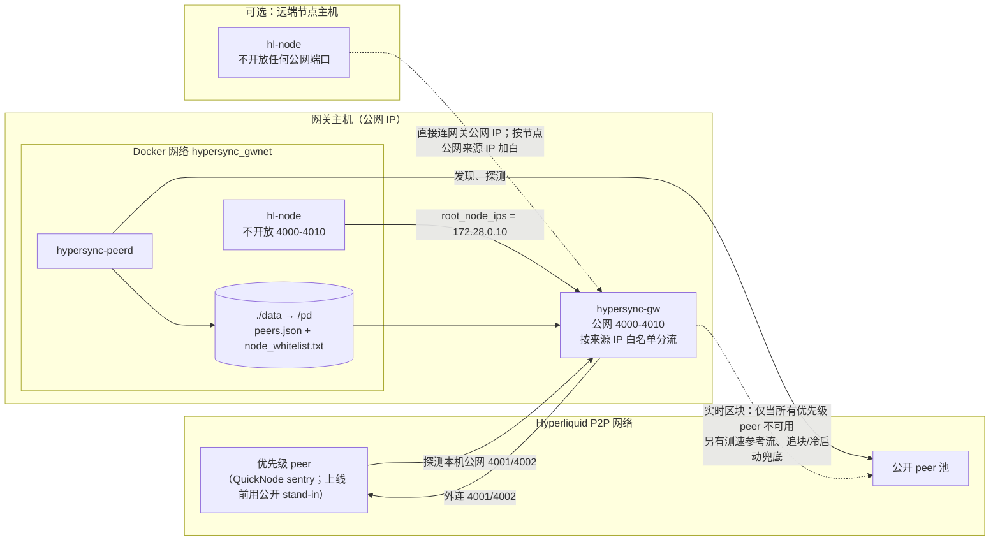

# hypersync 部署指南

本文档说明怎样把 hypersync 部署到运行 Hyperliquid hl-node 的服务器上，以及怎样接入其它机器上的节点。
当前拓扑（网关直接在公网发布 4000-4010，按来源 IP 白名单分流，不再有独立应答器）于 2026-11-09 验证：
Linode 远端节点直连网关公网 IPv4、同机新节点经网关冷启动、两个节点同时由一个网关服务。更早的数据
（单节点同机约 41 h、Linode 经 WireGuard 10 h、受控停顿测试）来自 2026-10-28 ~ 11-03 的应答器拓扑，
网关版本 `18f6864`。从应答器拓扑升级、或回滚到它，见第 12 节。

## 1. 拓扑



- **网关**为每个节点挑一个上游 peer，转发状态数据（冷启动）、实时区块（4001）和追块请求（4002），并在上游停顿、
  落后或异常时几秒内换掉它。一个网关可以同时服务多个节点（按节点来源 IP 区分）。
- **peerd** 发现并探测公开 peer，按约 120 s 一轮运行，得到可用的 peer 池时更新 `data/peers.json`。
- **优先级 peer**（`HYPERSYNC_PRIORITY_PEERS`）优先使用。默认独占模式下，节点的**实时区块**只在全部优先级 peer
  都不可用时才来自公开池；公开池另有三处用途：两条测速参考流（只测速，不给节点供块）、冷启动在优先级 peer
  领先 8 s 仍未成功后可参与竞争、单个 4002 追块请求在优先级 peer 6 s 未应答后可转给公开池。
- **公网探测应答已并入网关**：网关发布 4000-4010，连接的来源 IP 决定服务。白名单内来源得到完整节点服务；
  其它来源在 4001 得到 `peer full`、在 4002 得到空 peer 表或 `Peer-only`，其余端口立即关闭，不会创建节点状态、
  外连上游或收到区块。节点因此不需要任何公网端口。
- 节点只连网关（`try_new_peers: false`），不再直接连公网 peer。

## 2. 关键结论

- **白名单是公网安全边界。** 白名单内来源能触发约 5.8 GB 的状态数据转发，只填写自己的节点来源 IP/CIDR。
  网关拒绝以空白名单启动；`HYPERSYNC_NODE_WHITELIST` 与 `data/node_whitelist.txt` 每 30 s 重读，删除条目只影响新连接。
- **资源**：单节点测试中网关与 peerd 合计 < 100 MB 内存（网关峰值实测 69 MB，稳态约 6 MB；peerd ~18 MB），
  CPU ~1%。不开 `--cache` 时，每个进行中的冷启动会让网关多占约 64 MB，多个节点同时冷启动时相应增加。内存压力全部来自 hl-node：同机测试里它从 ~15 GiB 涨到 30+ GiB，62 GB 主机上每 3~6 小时低内存重启一次，
  偶尔先冻结 20 分钟。**hl-node 所在主机建议 ≥128 GB。** 网关可以放在小机器上（远端节点直接连接公网网关，见第 9 节）。
- 默认不开 `--cache`（见第 13 节），节点冷启动时网关透明转发一个正在提供状态的 peer。
- 网关是单点：节点只连网关。网关靠 `restart: unless-stopped` 自动拉起，重启时节点会断开几秒后自动重连。
  网关同时负责公网探测应答：网关重启或因配置错误反复退出时，上游 peer 的回访探测也没人应答
  （旧版独立应答器会继续应答），所以要让网关尽快恢复。
- 优先级 peer 的 IP 在所有日志里只显示为 `prio-1..N`；`.env` 已在 `.gitignore` 里，不要提交或外传。

## 3. 前置条件

- Docker 和 Docker Compose。
- 本机公网 IP：`curl -4 ifconfig.me`。
- 已有节点时，确认它的容器名、compose 目录和数据卷：

```sh
docker ps
docker volume ls | grep -i hyper
docker inspect <HL_NODE_CONTAINER> --format '{{json .Mounts}}'
```

下文假设节点的 compose 项目在 `~/node`、项目名 `hyperliquid`、数据卷 `hyperliquid_hl-data`、服务名 `node`，按实际情况替换。

## 4. 拉代码、构建镜像

```sh
git clone git@github.com:bufrr/hypersync.git /opt/hypersync
cd /opt/hypersync && git checkout main && mkdir -p data
docker compose build              # 生成 hypersync:latest
```

已有仓库时：`git pull && docker compose build`。

## 5. 配置 `.env`

在仓库根目录创建 `.env`：

```sh
# 所有自有节点的公网 IP（逗号分隔）：peerd 不会把它们放进公开 peer 池
# （只过滤公开池；不要把自有节点 IP 写进下面的优先级列表）
HL_SELF_IP=<本机公网 IP>[,<其它节点公网 IP>...]
# 优先级 peer（QuickNode sentry；上线前用测量过的公开 stand-in）
HYPERSYNC_PRIORITY_PEERS=<IP1>,<IP2>,<IP3>
# 必须有几个优先级 peer：数量不足或有非法、私网、重复地址时，网关和 peerd 都拒绝启动
HYPERSYNC_PRIORITY_PEERS_EXPECTED=3
# 允许得到完整节点服务的来源 IP/CIDR（逗号分隔）。同机默认动态 gwnet 池：
HYPERSYNC_NODE_WHITELIST=172.28.0.128/25
# 远端节点时追加其公网 IPv4 来源地址，例如：HYPERSYNC_NODE_WHITELIST=172.28.0.128/25,203.0.113.7
# 也可在 data/node_whitelist.txt 中每行写一个条目；两来源取并集，每 30 s 重读。
# 可选：只在一个宿主机地址上发布网关的 4000-4010；默认发布到所有地址
HYPERSYNC_PUBLIC_BIND=<本机公网 IP>
# 本部署用到的全部 compose 文件（冒号分隔）。写在这里后，每条 docker compose 命令都会自动带上它们，
# 升级、回滚、重建时不会漏掉 overlay。
# 同机读取节点 tcp_lz4_stats 时加 docker-compose.colocated.yml
COMPOSE_FILE=docker-compose.yml
```

**严禁**用覆盖 gwnet 网桥网关 `172.28.0.1` 的条目（如 `172.28.0.0/24`）或 `/0`。Docker userland proxy
转发的 IPv6、hairpin 连接会以该地址为来源，覆盖它等于把全网加入白名单。网关会拒绝这类条目：日志里出现
`node whitelist: entry ... REJECTED`，该条目不生效（只剩被拒条目时网关拒绝启动）；`/0` 写在环境变量里时，
启动检查直接报错退出。远端节点只能用 IPv4 加白（第 9 节）。

其它可调项见 README 的 Configuration 表。几点说明：

- `HYPERSYNC_PRIORITY_EXCLUSIVE` 默认 `1`（独占）：节点的实时区块会话只在每个优先级 peer 都不可用时才用公开池
  （冷启动、4002 和测速参考流的例外见第 1 节）。
- 启动检查覆盖节点白名单、优先级 peer 和网关的各项参数（`HYPERSYNC_NODE_WHITELIST`、`HYPERSYNC_PRIORITY_*`、
  `HYPERSYNC_FAILOVER_*`）。值不合法时进程退出，日志里是 `[main] invalid environment: ...`，不会悄悄退回默认值。
  环境变量与文件合并后没有任何有效条目时网关也退出（exit 2）。`HL_SELF_IP` 不在检查范围内，写错时这些 IP
  只是不会被排除，需要自己核对。

## 6. 启动 peerd 和网关

```sh
cd /opt/hypersync
# 确认 COMPOSE_FILE 生效：看展开后的实际配置，而不是服务名（缺 overlay 时服务名一样）
docker compose config | grep -E "host_ip|/hl/node|4000-4010"
#   gw 应发布 4000-4010（设置 HYPERSYNC_PUBLIC_BIND 时有 host_ip）；读 tcp_lz4_stats 时 peerd 应挂载 /hl/node1
# 已有节点仍占用宿主机 4000-4010 时先只启动 peerd，网关按第 8.1 节在节点释放端口后启动：
docker compose up -d peerd
# 全新节点或端口已释放时改为：
# docker compose up -d gw peerd
```

本机已有节点数据卷时，建议在 `.env` 里写 `COMPOSE_FILE=docker-compose.yml:docker-compose.colocated.yml`，
让 peerd 读节点的 tcp_lz4_stats（发现 peer 最好的来源）。这个 overlay 默认挂载卷 `hyperliquid_hl-data`，
不同名时改 `docker-compose.colocated.yml`。

检查：

```sh
docker logs hypersync-gw 2>&1 | grep -E "upstream tiers|invalid environment"
#   期望：[gw] upstream tiers: priority peers=3 max_sessions=none stage=1500ms bootstrap=prefer exclusive=true
docker logs -f hypersync-peerd
#   期望：[peerd] ... candidates=N ... live=N round_tip=Some(...) ...   （live 稳定在 4 以上再切节点）
docker inspect hypersync-gw -f '{{json .HostConfig.PortBindings}}'
#   应包含 4000-4010；白名单之外的公网连接只会得到探测应答
```

## 7. 修改节点配置

**节点 `docker-compose.yml`**（`~/node`）：

```yaml
networks:
  default:
  gwnet:                       # 网关的网络，由 hypersync 项目创建
    external: true
    name: hypersync_gwnet

services:
  node:
    ports:
      - "127.0.0.1:3001:3001"  # 只保留需要的 RPC 端口，并绑定到本机或私网地址（要对外开放时加防火墙）；
                               # 去掉 4000-4010，公网探测由网关应答
    networks: [default, gwnet]
    volumes:
      - hl-data:/home/hluser/hl/data
      # 绑定挂载：容器重建后网关地址不会丢
      - ./override_gossip_config.json:/home/hluser/override_gossip_config.json
    # mem_limit: 52g           # 内存紧张的主机建议加：内存满时容器被直接杀掉并重启（几分钟恢复），
    #                          # 不会拖着整台主机卡 20 分钟。代价是重启更频繁
```

**`~/node/override_gossip_config.json`**（先备份旧的）：

```json
{"root_node_ips":[{"Ip":"172.28.0.10"}],"try_new_peers":false,"chain":"Mainnet"}
```

`172.28.0.10` 是 hypersync `docker-compose.yml` 里 gw 的 `ipv4_address`，是固定地址。

## 8. 切换顺序与验收

### 8.1 已有节点（从直连切到网关）

1. 节点保持原样运行，完成第 5 节白名单配置，先执行 `docker compose up -d peerd`，等 peerd `live` 稳定在 4 以上。
2. 改好第 7 步的两个文件。
3. 先重建节点释放宿主机 4000-4010，再立即启动网关（新版网关也要发布这些端口）：

```sh
cd ~/node && docker compose up -d                                  # 节点不再开放 4000-4010
cd /opt/hypersync && docker compose up -d gw peerd
```

### 8.2 全新节点

```sh
cd /opt/hypersync && docker compose up -d gw peerd
cd ~/node && docker compose up -d
```

全新数据卷的节点冷启动实测约 7 分钟追平：几秒内网关给它转发状态数据，2–3 分钟后接上实时区块。

冷启动过程（2026-11-15 在 16 核 Linode 上实测，状态服务器约 24 MB/s；详见 `docs/hl-p2p-protocol.md` §7a）：

1. **abci_state（约 1.4 GB，约 1 分钟）**：节点从连上起只给这一帧约 60 s（含网关选服务器的时间），超时就从头重来，所以网关只选能在剩余时间内发完的服务器。节点日志每 4 MB 一行 `reading bytes for abci_stream recv greeting: X/Y`。
2. **加载状态（约 1–2.5 分钟）**：出现 `received abci greeting` 和 `computed l1 hash`。这段时间节点**不读网络数据**，
   网关对它的写入会卡住，属于正常现象（网关在冷启动连接的前 15 分钟允许单次写入卡 300 s）。
3. **EVM KVs（约 4.4 GB，约 3 分钟）**：**节点在这一阶段不打任何进度日志**。要看进度只能看网关一侧的连接字节数：
   `nsenter -t $(docker inspect -f {{.State.Pid}} hypersync-gw) -n ss -tni dst <节点IP>` 里的 `bytes_sent`。
4. **完成**：数据卷里出现 `hyperliquid_data/visor_abci_state.json`，节点开始 `querying client blocks` /
   `added client block batch during bootstrap`，经 4002 追块（每批 100 轮），约 10 分钟追到链头后转为 `applied block`。

EVM KVs 阶段一旦断开，节点会打 `Evm Kvs read error: early eof`，并**从头**重新下载 abci_state，没有断点续传。
有的状态服务器 abci_state 发得很快、EVM KVs 却只有每秒几百 KB（实测 0.26 MB/s，要约 2 小时），而且不会完全停住；
网关对这种服务器按速率切断（见第 11 节），节点几秒后换一个服务器重来；所有候选都慢时，网关保留慢服务器让它下完，而不是无限重来。

### 8.3 验收

```sh
docker logs -f hypersync-gw 2>&1 | grep -E "bootstrap|selected live|session (start|ended)"     # 网关日志在 stderr
```

期望依次看到：

```text
[gw] [<node>] node bootstrap via prio-N tier=prio (abci_state ... bytes, prefetched 64 MB); active set
[gw] [<node>] selected live peer prio-N tier=prio first_round=... greeting=...
```

端口与网络：

```sh
ss -ltn | grep -E ':(400[0-9]|4010) '      # 网关发布 4000-4010；节点不再发布这些端口
docker ps --format 'table {{.Names}}\t{{.Ports}}' | grep -E 'hypersync|hyperliquid'
docker logs hypersync-gw 2>&1 | grep "\[gw\] \[public\]" | tail -1     # 启动 10 分钟后才有第一条统计
#   [gw] [public] last 600s: 4001 probes=... | ... other ports=... busy=0 | from priority peers=...
```

节点延迟。逐块记录 `begin_block_wall_time - block_time`，正常 0.7~1 s，整点前后会有 2 s 左右的停顿：

```sh
sudo tail -1 /var/lib/docker/volumes/hyperliquid_hl-data/_data/node_fast_block_times/$(date -u +%Y%m%d)
```

通过标准（至少观察 30 分钟）：

- 延迟中位数 ≤1 s，没有持续超过 5 s 的分钟（低内存重启和优先级 peer 停顿除外，见第 11 节）。
- 实时区块会话没有落到公开池：没有 `push session start ... tier=pool`。冷启动或 4002 偶尔出现 `tier=pool` 是兜底，
  不算失败；频繁出现说明优先级 peer 有问题。
- 没有**持续**的 `round too large`。追到链头附近时偶尔出现是正常的。
- peerd `live` 不长期为 0；网关 `[public]` 统计的 `busy=0`。
- `docker inspect hypersync-gw hypersync-peerd --format '{{.Name}} restart={{.RestartCount}} oom={{.State.OOMKilled}}'`
  全部是 `restart=0 oom=false`。

## 9. 远端节点（节点在另一台机器）

远端节点直接连接网关公网 IP，不再需要 WireGuard；节点自身仍不需要开放入站端口。

1. 把远端节点的公网 IP 加进 `HL_SELF_IP`，并把它的公网 IPv4 来源地址/CIDR 加进
   `HYPERSYNC_NODE_WHITELIST`（或 `data/node_whitelist.txt`），例如 `203.0.113.7`。
2. 网关的 compose 默认已发布 4000-4010；需要限定宿主机地址时设置 `HYPERSYNC_PUBLIC_BIND`，然后执行
   `docker compose up -d gw peerd`。网关主机有防火墙时放行 4000-4010 入站（白名单外来源只会得到探测应答）。
3. 远端节点的 `override_gossip_config.json` 把 `root_node_ips` 写为网关公网 **IPv4** 地址；compose 不开放
   4000-4010，也不需要加入 `hypersync_gwnet`。
4. 只能用 IPv4：Compose 下 IPv6 连接经 Docker 代理到达网关时来源变成 `172.28.0.1`，节点的 IPv6 地址
   永远匹配不上白名单，只会得到探测应答。
5. 每个节点必须以不同来源 IP 到达网关。两个远端节点经过同一个 NAT 会被当成一个节点，不能这样部署。

## 10. 多个节点共用一个网关

- 网关按 TCP 来源 IP 区分节点：每个节点在网关看来必须是不同且已加白的来源 IP，比如不同的容器 IP 或公网 IP。
  经过同一个 NAT 的两个节点会被当成一个，不能这样部署。
- 每个节点都指向网关；`HL_SELF_IP` 包含所有节点的公网 IP（防止它们进入公开池）。
- 同机多个节点时，可以在 `docker-compose.colocated.yml` 里给 peerd 多挂几个数据卷：

```yaml
volumes:
  node1-hl-data: { external: true, name: hyperliquid_hl-data }
  node2-hl-data: { external: true, name: hyperliquid2_hl-data }
services:
  peerd:
    environment:
      HL_STATS_DIR: /hl/node1/tcp_lz4_stats,/hl/node2/tcp_lz4_stats
    volumes:
      - ./data:/pd
      - node1-hl-data:/hl/node1:ro
      - node2-hl-data:/hl/node2:ro
```

## 11. 日常监控：日志含义

网关的 `session ended` 行以 `reason=` 说明原因。上游的问题会让该 peer 冷却 30 s，节点几秒内重连到另一个 peer。

| `reason=` | 含义 | 处理 |
|---|---|---|
| `active peer stalled behind the freshest stream by N rounds` | 上游停了或断续发块，其它流还在前进；约 6 s 切走 | 正常。三个公开 stand-in 实测约每 3–4 个在线小时一次，节点最多落后 ~10 s |
| `active stream error: active peer lags the freshest stream ...` | 上游持续落后 100 轮以上 5 s | 正常处理 |
| `active stream error: idle timeout` / `early eof` | 上游 10 s 没数据，或主动断开 | 正常处理 |
| `node outbound write failed` / `node outbound write timeout` | **上游**不再接收节点发出的数据（5 s 写不进去）。名字里有 node，但算上游故障 | 正常处理 |
| `node write failed` / `node write timeout` / `node outbound ended` | 节点那一侧断了：重启，或卡住 30 s 不读数据 | 看节点：通常是 hl-visor 低内存重启 |
| `node catch-up not converging` | 节点陷在小范围追块循环（hl-node 的已知问题，实测落在落后约 1,050–1,110 轮处）：整整 3 分钟里各批追块落后最新轮次的距离，最大值和最小值之差小于 150 轮，且没有缩小 50 轮以上，且请求范围的中位数小于 64 轮。网关结束会话，让节点重连后一次追完 | 正常处理；每节点每 5 分钟最多一次 |
| `returning to a priority peer` | 节点之前落到了公开池，现在回到优先级 peer | 正常 |

冷启动（bootstrap）相关的行，不带 `reason=`：

| 日志 | 含义 | 处理 |
|---|---|---|
| `[gw] bootstrap via <peer> below 1000 KB/s after N MB; cutting it` | 状态服务器在等待它的 120 s 里平均不到 1 MB/s（超过 5.2 GB 后门槛降到 400 KB/s，超过 7 GB 不再检查）。网关切断，20 分钟内（优先级 peer 为 5 分钟）不再用它做冷启动（仍可提供实时区块），节点几秒内换服务器重新冷启动 | 正常。同一个节点反复出现说明可用的状态服务器都很慢：看 peerd 的 `live` 数 |
| `[gw] [<node>] bootstrap via <peer> ended inside the abci_state (N of M MB); not used for bootstraps for 20 min` | 状态服务器在 abci_state 中途停住，节点自己约 20–30 s 后放弃（节点日志 `could not read abci state ... deadline has elapsed`）。20 分钟内（优先级 peer 为 5 分钟）不再用它做冷启动 | 正常；节点重启也会触发一次。优先级 peer 被标记时冷启动先换另一个优先级 peer，三个都被标记才用公开池 |
| `[gw] bootstrap candidate <peer> too slow for the node's abci_state deadline (X MB/s, needs Y)` | 节点从连上起只给 abci_state 约 60 s（选服务器的时间也算在内）。这个候选按预取速率赶不上，网关换下一个，节点不用等 60 s 超时再重来 | 正常；只出现这一行而没有后续 `node bootstrap via` 时，看 peerd 的 `live` 数 |
| `every bootstrap candidate trickled recently; keeping a slow server this time (no rate cut)` | 候选的状态服务器 20 分钟内都被切过。为免无限重下，这次保留慢服务器，只按 60 s 无数据切断 | 冷启动会很慢但能完成；持续出现说明 peer 池太小或本机 IP 被普遍限速 |
| `no peer serving abci_state right now` | 这一轮没找到愿意发状态的服务器 | 偶尔正常；持续出现时检查本机公网 4001/4002 是否有应答（`[gw] [public]` 统计） |
| 节点日志 `Evm Kvs read error: early eof` | 冷启动在 EVM KVs 阶段断了，节点会从头再下 | 偶发且紧跟一条 `cutting it` 是预期的；没有 `cutting it` 却反复出现，说明连接在别处被断（节点重启、网关重启） |

需要关注的情况：

- 出现 `push session start ... tier=pool`：节点的实时区块落到了公开池，说明所有优先级 peer 同时不可用。
  冷启动或 4002 日志里的 `tier=pool` 只是兜底，偶尔出现不用处理。
- 某个优先级 peer 按在线时间算故障率持续明显高于其它几个：考虑换掉它。注意：按次数统计会冤枉连接延迟最低、
  因此最常被选中的那个 peer。
- 节点 `child_low_memory: true`（hl-visor 日志）：主机内存不足，见第 2 节。
- 节点冷启动后长时间没有 `selected live peer`：看 peerd 的 `live` 和网关的 `live attempt failed`。

## 12. 升级与回滚

**升级网关**（已经是白名单版本时）：

```sh
cd /opt/hypersync
mkdir -p data/gwlogs
docker logs -t hypersync-gw > data/gwlogs/gw-$(date -u +%Y%m%dT%H%M%SZ)-pre-upgrade.log 2>&1
docker tag hypersync:latest hypersync:prev                # 留一份旧镜像
git pull && docker compose build
docker compose up -d gw peerd                             # overlay 由 COMPOSE_FILE 自动带上；节点断开几秒后自动重连
```

**回滚网关**（回到另一个白名单版本）：`docker tag hypersync:prev hypersync:latest && docker compose up -d gw peerd`

### 12.1 从应答器拓扑升级（第一次升级到白名单版本）

旧部署有一个 `hypersync-responder` 容器占着公网 4001/4002，网关不对公网发布端口；新网关要自己发布
4000-4010，且没有白名单拒绝启动。按顺序做，否则新网关起不来、节点断开：

1. 保存日志、留旧镜像（同上），并记下当前提交，回滚时要用：
   `git rev-parse HEAD > data/pre-whitelist-commit`
2. `.env`：加 `HYPERSYNC_NODE_WHITELIST`（同机节点 `172.28.0.128/25` 或它们的固定 gwnet 地址；远端节点
   加它们的公网 IPv4）。`HYPERSYNC_RESPONDER_BIND` 不再使用；需要限定发布地址时改用 `HYPERSYNC_PUBLIC_BIND`
   （注意它限定的是全部 4000-4010）。
3. 用过 WireGuard 的部署（旧版第 9 节）：从 `COMPOSE_FILE` 删掉 `docker-compose.wg.yml`，新 compose 已发布
   4000-4010，overlay 再发布一次会端口冲突。最平滑的过渡是把远端节点的 WireGuard 隧道地址也加进白名单
   （不设 `HYPERSYNC_PUBLIC_BIND` 时网关在所有地址上发布，包括隧道地址），节点不用改就能继续连；之后再逐台把
   `root_node_ips` 改成网关公网 IPv4、把节点公网 IPv4 加白，最后去掉 WireGuard。
4. 拉代码、构建，删掉旧应答器后立即启动新网关。新 compose 里已经没有 `responder` 服务，`docker compose`
   不会自己删它：

```sh
git pull && docker compose build
docker compose config | grep -E "4000-4010"               # gw 应发布 4000-4010，且没有 wg overlay 的第二份映射
docker rm -f hypersync-responder                          # 释放公网 4001/4002（到下一行起来之间几秒没人应答探测）
docker compose up -d gw peerd
```

5. 验收：`docker logs hypersync-gw 2>&1 | grep -E "node whitelist|bind :"` 列出预期的白名单，没有 `REJECTED`
   也没有 `bind`；每个节点的 `applied block` 持续增长；10 分钟后 `[gw] [public]` 统计有 `from priority peers=...`。
6. 新版本稳定后删掉白名单之前的镜像，免得以后被当成回滚镜像（这次第 1 步打的 `hypersync:prev` 就是）：
   `docker image rm hypersync:prev`。

### 12.2 回滚到应答器拓扑（白名单之前的版本）

**不能只换镜像。** 新 compose 把 4000-4010 发布到公网，而白名单之前的网关不检查来源，任何人都能拿到完整
服务（包括约 5.8 GB 的状态转发）。代码、compose 和镜像要一起回退：

```sh
cd /opt/hypersync
git checkout $(cat data/pre-whitelist-commit)             # 代码和 compose 回到应答器拓扑
docker compose build                                       # 旧版本镜像
# .env：恢复 HYPERSYNC_RESPONDER_BIND；用过 WireGuard 时把 docker-compose.wg.yml 加回 COMPOSE_FILE
docker compose up -d gw peerd                              # 按旧 compose 重建网关：不再发布公网 4000-4010
docker compose --profile public up -d responder            # 应答器接管公网 4001/4002
```

远端节点要改回经 WireGuard 连接（旧网关不对公网开放），否则连不上。

**整体回滚到直连**（先停 hypersync，再让节点重新开放端口，避免和网关抢端口）：

1. 在每台节点主机上恢复原来的 `override_gossip_config.json` 和节点 compose（重新开放 4000-4010），先不要重建。
   远端节点还要恢复它的主机或云防火墙入站 4000-4010；否则节点虽然能外连、`applied block` 也在增长，
   但上游 peer 的回访探测进不来，会被降级。
2. 在网关主机上停掉 hypersync，释放公网 4000-4010：
   `cd /opt/hypersync && docker compose stop gw peerd`
   （容器、镜像和 `.env` 都保留，`start` 可恢复）。节点会暂时收不到区块，直到下一步完成。
3. 在每台节点主机上重建节点：`cd ~/node && docker compose up -d`，确认它重新连上公网 peer，并且 `applied block` 持续增长。

## 13. 状态缓存 `--cache`（可选，默认关闭）

默认 `gateway /pd/peers.json --push` 不缓存状态数据：节点冷启动时网关透明转发一个正在提供状态的 peer
（独占模式下优先用优先级 peer）。开启 `--cache` 后网关会常驻一份完整状态（~5.8 GB），最多同时 ~3 份（~17 GB）。
和 hl-node 同机时，这曾把主机推过 hl-visor 的低内存重启阈值。

开启方法：在 `docker-compose.yml` 的 gw `command` 末尾加 `"--cache"` 后 `up -d`。日志里会出现 `bootstrap cache persisted`，
并生成 `data/bootstrap.cache`（超过 8 分钟的缓存不会回放）。注意：

- 缓存的后台刷新**从不使用优先级 peer**，只从公开池抓取。缓存可能被恶意的状态 peer 污染，所以只有在信任公开池的状态来源时才适合开启。
- 缓存只省掉冷启动时向外部拉取状态这一步。节点之后仍然要从上游 peer 接实时区块，追块也仍然走 4002。

## 14. 常见问题

**网关要不要 host network？** 不要。同机用 `hypersync_gwnet` bridge 网络，节点连 `172.28.0.10`。
远端节点直接连接网关公网 IP，并按来源 IP 加白。

**网关可以发布到公网吗？** 可以，但必须配置节点白名单。白名单外来源只会得到探测应答或立即关闭；
不要加入 `172.28.0.1` 或包含它的网段（原因见第 5 节）。

**节点还需要公网端口吗？** 不需要。上游 peer 的回访探测由网关应答；节点的数据全部经网关。

**要不要先停节点？** 已有节点时不要。先让它照常运行，等 peerd 热起来（第 8.1 节），再切换。

**节点内存高是不是网关导致的？** 不是。网关稳态只有几 MB，峰值 69 MB；内存几乎全是 hl-node 用的，
用 `docker stats` 分别看。

**peerd `live=0` 能不能切？** 不建议。先查 `data/peers.json`、peerd 日志里的 `reasons={...}`、`HL_STATS_DIR` 挂载，
必要时 `docker restart hypersync-peerd`。独占模式下节点主要用优先级 peer，但公开池是它们全部不可用时唯一的退路，
测速参考流、冷启动和 4002 的兜底也来自公开池。

**优先级 peer 怎么换？** 改 `.env` 的 `HYPERSYNC_PRIORITY_PEERS` 后执行
`docker compose up -d --force-recreate gw peerd`。网关用这个列表统计来自优先级 peer 的探测次数。
overlay 由 `COMPOSE_FILE` 自动带上。
